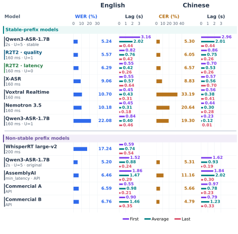
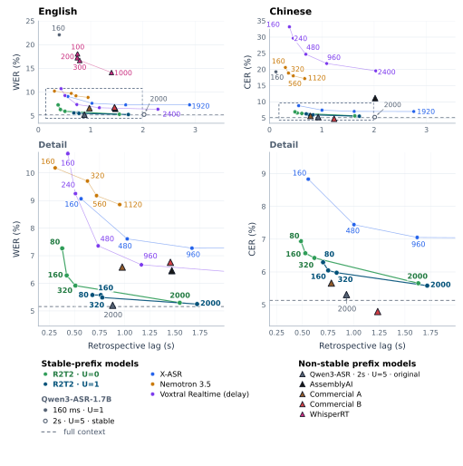

<div align="center">
    
    <h1>Confucius4-<span style="color: #4F8CFF;">R2T2</span>: A Stable-Prefix Streaming ASR Model for Real Real-Time Transcription</h1>
        <p>
        <b>
            <span style="color: #4F8CFF;">R</span>eal
            <span style="color: #4F8CFF;">R</span>eal-<span style="color: #4F8CFF;">T</span>ime
            <span style="color: #4F8CFF;">T</span>ranscription
        </b>
    </p>
</div>

<div align="center">
    <a href="./README.zh.md"></a>
    &nbsp;&nbsp;&nbsp;&nbsp;
    <a href="./LICENSE"></a>
    &nbsp;&nbsp;&nbsp;&nbsp;
    <a href="https://r2t2.youdao.com/demo"></a>
    &nbsp;&nbsp;&nbsp;&nbsp;
    <a href="https://huggingface.co/netease-youdao/Confucius4-R2T2"></a>
    &nbsp;&nbsp;&nbsp;&nbsp;
    <a href="https://modelscope.cn/models/netease-youdao/Confucius4-R2T2"></a>
    &nbsp;&nbsp;&nbsp;&nbsp;
    <a href="https://arxiv.org/abs/2611.06043"></a>
    &nbsp;&nbsp;&nbsp;&nbsp;
    <a href="https://r2t2.ai/"></a>
    &nbsp;&nbsp;&nbsp;&nbsp;
</div>
<br>

Confucius4-R2T2 is a low-latency, high-accuracy stable-prefix streaming automatic speech recognition (ASR) model. It supports configurable decoding chunks from 80 ms to 2 s. The model operates in a monotonic output mode, committing transcript text permanently without revising previous words. This is critical for applications where text must be processed or acted upon instantly. The result is a smoother user experience, with fewer disruptive text revisions and less visual flicker in real-time applications such as real-time live captioning and subtitling, simultaneous speech translation, downstream NLP pipelines and LLM agents.

R2T2, short for Real Real-Time Transcription, adapts **Qwen3-ASR-1.7B** with **Longest Stable Prefix (LSP) learning** on 1,500 hours of Chinese and English audio. Two-stage training with SFT and GRPO updates only the language decoder; the pre-trained audio encoder and projector remain frozen, with no architectural changes. LSP targets and an explicit `Wait` action teach the model what it can commit and when it needs more audio.

- **Accurate streaming recognition** — At 160 ms with one provisional token, R2T2 reaches a recognition error rate of **5.76%**, compared with **21.01%** for the base model at the same streaming setting. It ranks first among the evaluated open-source models and closes the gap with the full-context reference (**5.15%**) across 13 English and Chinese test sets.
- **Stable output** — Both quality-priority (`U=1`) and latency-priority (`U=0`) modes release only committed text; the provisional suffix stays internal.
- **Configurable responsiveness** — Chunk duration and provisional-token budget control the accuracy–emission-lag trade-off without retraining. Reported emission lag excludes serving and network time.
- **Offline and streaming inference** — The same checkpoint supports full-context transcription and streaming use.
- **Inference backends** — vLLM inference, a Hugging Face `transformers` offline route, and optional llama.cpp decoding are available.
- **Context and hotwords** — Native support for topic and vocabulary hints.
- **Multilingual transfer** — Post-training uses Chinese and English; streaming improvements also extend to 18 evaluated test sets in ten additional languages.

Read the [paper on arXiv](https://arxiv.org/abs/2611.06043) for the formal definitions, proofs, and full evaluation details.

## Table of Contents

- [Overview](#overview)
- [Demo](#demo)
  - [Side-by-side comparison with GPT-Live-Transcribe](#side-by-side-comparison-with-gpt-live-transcribe)
  - [Additional resources](#additional-resources)
- [Evaluation](#evaluation)
  - [Streaming performance](#streaming-performance)
  - [Accuracy](#accuracy)
    - [English](#english)
    - [Chinese](#chinese)
  - [Cross-language transfer](#cross-language-transfer)
- [Model Checkpoints](#model-checkpoints)
- [Installation](#installation)
  - [Clone the repository](#clone-the-repository)
  - [Option 1: Conda](#option-1-conda)
  - [Option 2: uv](#option-2-uv)
- [Docker (recommended)](#docker-recommended)
  - [1. Start a container](#1-start-a-container)
  - [2. Run the example inside the container](#2-run-the-example-inside-the-container)
  - [3. Manage the container](#3-manage-the-container)
- [Quick Start](#quick-start)
  - [Configuration](#configuration)
- [Python API](#python-api)
  - [vLLM backend](#vllm-backend)
    - [Offline transcription](#offline-transcription)
    - [Streaming transcription](#streaming-transcription)
  - [llama.cpp backend](#llamacpp-backend)
- [WebSocket Server](#websocket-server)
  - [Start and stop the server](#start-and-stop-the-server)
  - [WebSocket endpoint](#websocket-endpoint)
  - [Message format](#message-format)
  - [Example client](#example-client)
- [Supported Languages](#supported-languages)
- [Community & Contact](#community--contact)
  - [WeChat Group](#wechat-group)
  - [Discord Server](#discord-server)
  - [Business contact](#business-contact)
  - [GitHub Issues](#github-issues)
- [Acknowledgements](#acknowledgements)
- [Citation](#citation)
- [License](#license)

---

## Overview

<div align="center">
  
  <p><i>Figure 1. Overall framework of R2T2.</i></p>
</div>

## Demo

### Side-by-side comparison with GPT-Live-Transcribe

<div align="center">
  <video controls playsinline preload="metadata" width="90%" src="https://github.com/user-attachments/assets/1b21c04a-766a-434f-96dc-580376b305f1" title="GPT-Live-Transcribe and R2T2 processing the same audio together in real time — a side-by-side comparison.">
    <!-- GitLab converts this fallback image into a video player. -->
    
  </video>
  <p><i>Figure 2. GPT-Live-Transcribe and R2T2 processing the same audio, shown together in real time — a side-by-side comparison.</i></p>
</div>

### Additional resources

More demonstrations and comparisons are available at [r2t2.youdao.com/examples](https://r2t2.youdao.com/examples/), covering chunk size, context and hotwords, code-switching, multilingual speech, noise, and long-form speech.

## Evaluation

> Authors and maintainers of the compared models are welcome to contact us through the repository issue tracker to verify or discuss the evaluation.

### Streaming performance

`U` is the number of provisional tokens withheld from release. At 160 ms, `U=1` prioritizes recognition quality and `U=0` prioritizes lower emission lag. Both R2T2 modes preserve committed text. The figures also compare the base model at 2 s with a visible revisable suffix versus a withheld suffix.

<div align="center">
  
  <p><i>English WER, Chinese CER, and retrospective emission lag. First and Last average the lag of the first and last matched units; Average is the mean lag over all evaluated datasets.</i></p>
</div>

<div align="center">
  
  <p><i>Recognition–lag trade-offs across chunk sizes and provisional-token budgets. Curves connect measured settings; triangles denote configurations with revisable hypotheses.</i></p>
</div>

**Retrospective emission lag** is the audio-time difference between a reference unit's aligned end and the first permanently stable output. It is computed on correctly matched units after Levenshtein alignment; high-error utterances are excluded. Execution, queueing, transport, and rendering are excluded.

### Accuracy

English uses WER (%), Chinese uses CER (%); lower is better. Each dataset receives equal weight in the macro average.

In the full comparison below, **Base** means Qwen3-ASR-1.7B. All streaming columns use 160 ms except Base 2 s and WhisperRT (200 ms). Base 160 ms uses `U=1`; Base 2 s uses `U=5`. **†** marks reference-only configurations, excluded from rankings. **\*** marks visible revisable hypotheses. Bold marks the lowest eligible error in each row; N/A means unavailable.

#### English

| Dataset | Base offline† | Base 2 s†\* | Base 160 ms | R2T2 U=1 | R2T2 U=0 | X-ASR | WhisperRT\* | Nemotron 3.5 | Voxtral RT | AssemblyAI\* | Comm. A\* | Comm. B\* |
| --- | ---: | ---: | ---: | ---: | ---: | ---: | ---: | ---: | ---: | ---: | ---: | ---: |
| AMI | 9.18 | 9.25 | 24.79 | 10.07 | 10.40 | 14.41 | 24.19 | 18.11 | 17.58 | 12.00 | 13.27 | **8.44** |
| Giga-clean | 8.60 | 8.61 | 24.37 | **8.81** | 9.04 | 10.26 | 13.81 | 12.67 | 12.16 | 9.21 | 8.84 | 9.46 |
| LS-clean | 1.62 | 1.67 | 18.37 | 1.91 | 2.12 | 3.86 | 4.70 | 3.71 | 3.05 | 1.89 | 1.73 | **1.25** |
| LS-other | 3.39 | 3.54 | 25.74 | 4.12 | 4.55 | 9.64 | 9.86 | 8.27 | 8.70 | 3.37 | 3.57 | **2.48** |
| VoxPopuli | 3.12 | 3.02 | 20.71 | **2.29** | 3.54 | 5.68 | 8.28 | 5.69 | 8.00 | 4.75 | 3.17 | 3.14 |
| Earnings22 | 6.26 | 6.68 | 29.72 | 7.61 | 9.06 | 15.95 | 35.08 | 17.22 | 12.12 | **7.47** | 10.32 | 8.96 |
| TED-LIUM | 2.26 | 2.33 | 19.18 | **2.46** | 2.77 | 3.75 | 6.67 | 5.11 | 5.89 | 3.23 | 3.08 | 3.30 |
| EN-RealSI | 6.84 | 6.54 | 13.76 | **7.33** | 8.84 | 8.97 | 35.36 | 10.69 | 18.08 | 9.73 | 8.73 | 17.05 |

#### Chinese

| Dataset | Base offline† | Base 2 s†\* | Base 160 ms | R2T2 U=1 | R2T2 U=0 | X-ASR | WhisperRT\* | Nemotron 3.5 | Voxtral RT | AssemblyAI\* | Comm. A\* | Comm. B\* |
| --- | ---: | ---: | ---: | ---: | ---: | ---: | ---: | ---: | ---: | ---: | ---: | ---: |
| Wenet-net | 4.87 | 4.94 | 19.79 | 5.75 | 6.17 | 8.81 | N/A | 24.70 | 27.36 | 12.91 | 5.13 | **4.79** |
| Wenet-meeting | 5.85 | 5.97 | 20.38 | 6.74 | 7.34 | 11.33 | N/A | 20.18 | 66.50 | 11.84 | 7.07 | **3.75** |
| SPEECHIO-06 | 5.90 | 6.10 | 24.47 | 7.19 | 7.43 | 7.86 | N/A | 22.52 | 35.33 | 15.08 | 5.67 | **5.34** |
| SPEECHIO-07 | 6.15 | 6.19 | 21.16 | 7.29 | 7.94 | 11.22 | N/A | 24.28 | 26.84 | 10.84 | **6.45** | 6.46 |
| CN-RealSI | 2.91 | 3.34 | 10.72 | **3.27** | 3.98 | 4.92 | N/A | 11.52 | 9.92 | 5.15 | 3.99 | 3.64 |

### Cross-language transfer

The table covers 18 test sets across ten languages that were absent from post-training. Japanese, Korean, and Thai use CER; the remaining languages use WER. These test sets do not enter the main English/Chinese averages.

| Test set | Base offline | Base 2 s, U=5 | Base 160 ms, U=1 | R2T2 160 ms, U=0 | R2T2 160 ms, U=1 |
| --- | ---: | ---: | ---: | ---: | ---: |
| Arabic: FLEURS | 9.53 | 11.32 | 56.63 | 14.86 | 13.52 |
| German: FLEURS | 3.95 | 10.77 | 36.49 | 12.35 | 8.05 |
| German: MLS | 6.99 | 7.55 | 26.83 | 12.09 | 9.52 |
| Spanish: FLEURS | 2.63 | 3.55 | 31.00 | 5.22 | 3.97 |
| Spanish: MLS | 3.81 | 3.80 | 18.36 | 5.45 | 4.47 |
| French: FLEURS | 4.30 | 5.67 | 39.61 | 7.65 | 6.35 |
| French: MLS | 5.09 | 5.43 | 22.12 | 6.90 | 6.14 |
| Japanese: FLEURS | 5.42 | 7.23 | 36.07 | 10.15 | 8.66 |
| Korean: FLEURS | 4.22 | 6.20 | 40.66 | 6.77 | 7.52 |
| Portuguese: FLEURS | 4.47 | 5.02 | 23.94 | 8.02 | 6.76 |
| Portuguese: MLS | 6.43 | 6.65 | 20.94 | 8.64 | 7.41 |
| Russian: FLEURS | 4.94 | 6.95 | 53.92 | 11.26 | 8.26 |
| Thai: Common Voice | 3.50 | 3.62 | 24.12 | 5.58 | 5.18 |
| Thai: FLEURS | 6.81 | 8.40 | 21.25 | 10.14 | 9.83 |
| Thai: GigaSpeech2 | 12.39 | 12.97 | 18.43 | 15.39 | 14.93 |
| Vietnamese: Common Voice | 8.48 | 8.51 | 38.92 | 11.87 | 11.25 |
| Vietnamese: FLEURS | 6.99 | 8.66 | 28.11 | 11.88 | 10.89 |
| Vietnamese: GigaSpeech2 | 7.85 | 7.83 | 16.04 | 8.65 | 8.42 |
| **Macro average** | **5.99** | **7.23** | **30.75** | **9.60** | **8.40** |

## Model Checkpoints

The model weights are available on Hugging Face and ModelScope. Choose the
checkpoint that matches the inference backend:

| Inference backend | Model | Hugging Face | ModelScope | Description |
| ----------------- | ----- | ------------ | ---------- | ----------- |
| vLLM | `Confucius4-R2T2` | <a href="https://huggingface.co/netease-youdao/Confucius4-R2T2" title="Open Confucius4-R2T2 on Hugging Face"></a> | <a href="https://modelscope.cn/models/netease-youdao/Confucius4-R2T2" title="Open Confucius4-R2T2 on ModelScope"></a> | Standard checkpoint for the vLLM backend |
| llama.cpp | `Confucius4-R2T2-GGUF` | <a href="https://huggingface.co/netease-youdao/Confucius4-R2T2-GGUF" title="Open Confucius4-R2T2-GGUF on Hugging Face"></a> | <a href="https://modelscope.cn/models/netease-youdao/Confucius4-R2T2-GGUF" title="Open Confucius4-R2T2-GGUF on ModelScope"></a> | GGUF repository with several quantization variants |

## Installation

We recommend using a **fresh, isolated environment**. For local development and
source installation, use the **Conda** or **uv** environment below. **Docker** is
recommended for quickly running the project with CUDA and the runtime
preconfigured — see [Docker](#docker-recommended).

### Clone the repository

```bash
git clone https://github.com/netease-youdao/Confucius4-R2T2.git
cd Confucius4-R2T2
```

### Option 1: Conda

```bash
conda create -n confucius4-r2t2 python=3.12 -y
conda activate confucius4-r2t2

# Install the package with the vLLM backend
pip install -e .
```

### Option 2: uv

```bash
uv venv --python 3.12
source .venv/bin/activate

# Install the package with the vLLM backend
uv pip install -e .
```

Python 3.10+ is supported. Python 3.12 is the version we test against.

vLLM has strict CUDA / PyTorch compatibility requirements. If the install
fails to resolve, check the version matrix on the [vLLM website](https://docs.vllm.ai/)
and pin a combination that matches your CUDA runtime.

## Docker (recommended)

R2T2 runs out of the box on the official **Qwen3-ASR** Docker image, which already ships the required runtime libraries.

Pre-built image: [qwenllm/qwen3-asr](https://hub.docker.com/r/qwenllm/qwen3-asr).

Before you begin, install the [NVIDIA Container Toolkit](https://docs.nvidia.com/datacenter/cloud-native/container-toolkit/latest/install-guide.html) to enable GPU access from Docker. If Docker Hub access is slow or unreliable in your region, you may need to configure a registry mirror.

### 1. Start a container

```bash
LOCAL_WORKDIR=/path/to/your/workspace   # host path that will be mounted into the container
HOST_PORT=8000
CONTAINER_PORT=80

docker run --gpus all --name confucius4-r2t2 \
    -v /var/run/docker.sock:/var/run/docker.sock \
    -p $HOST_PORT:$CONTAINER_PORT \
    --mount type=bind,source=$LOCAL_WORKDIR,target=/data/shared/confucius4-r2t2 \
    --shm-size=4gb \
    -it qwenllm/qwen3-asr:latest
```

Your local workspace (`$LOCAL_WORKDIR`) — including a checkout of this repository and the R2T2 checkpoint — will be mounted inside the container at `/data/shared/confucius4-r2t2`. Host port `8000` is mapped to container port `80`; services running inside the container must bind to `0.0.0.0` (not `127.0.0.1`) for port forwarding to work.

### 2. Run the example inside the container

Once inside the container shell:

```bash
cd /data/shared/confucius4-r2t2/Confucius4-R2T2
MODEL_PATH=/data/shared/confucius4-r2t2/Confucius4-R2T2 \
    ./run_example.sh /path/to/audio.wav
```

### 3. Manage the container

```bash
# re-enter after exiting
docker start confucius4-r2t2
docker exec -it confucius4-r2t2 bash

# remove completely
docker rm -f confucius4-r2t2
```

## Quick Start

Grab any audio file (mono or stereo, any sample rate — it is resampled to 16 kHz internally) and run:

```bash
./run_example.sh /path/to/audio.wav \
    --model_path /path/to/Confucius4-R2T2 \
    --infer_mode stream_vllm \
    --language Chinese \
    --chunk_size_ms 160
```

Logs are written to `run_example.log` by default. Run `./run_example.sh --help` to see the full flag list.

### Configuration

`run_example.sh` accepts the following environment variables. Supply the model path and audio through environment variables or command-line arguments.

| Variable              | Default            | Description                                            |
| --------------------- | ------------------ | ------------------------------------------------------ |
| `MODEL_PATH`          | (required)         | Path or HF repo id of the R2T2 checkpoint              |
| `AUDIO`               | first CLI argument | Path to the input audio file                           |
| `INFER_MODE`          | `stream_vllm`      | `stream_vllm` or `onetime_vllm`                        |
| `LANGUAGE`            | `Chinese`          | Language hint (e.g. `Chinese`, `English`, …)           |
| `CHUNK_SIZE_MS`       | `160`              | Streaming chunk size (80 ms–2 s supported)             |
| `UNFIXED_TOKEN_NUM`   | `1`                | Provisional-token budget U: `1` for quality, `0` for latency |
| `LOOKAHEAD_MS`        | `160`              | Extra audio buffered for the first update only (ms) |
| `CONTEXT`             | `""`               | Context / hotword hint prepended to the prompt         |
| `CUDA_VISIBLE_DEVICES` | `0`                | GPU id(s) to expose                                    |
| `LOG_FILE`            | `run_example.log`  | Where to write logs                                    |

You can also call `example.py` directly and pass any of these as flags (`--audio`, `--model_path`, `--infer_mode`, `--language`, `--chunk_size_ms`, `--lookahead_ms`, `--unfixed_token_num`, `--context`).

## Python API

Audio inputs can be passed as a local path, a URL, base64 data, or a `(np.ndarray, sr)` tuple. Batched inference is supported. Remember to wrap vLLM code under `if __name__ == '__main__':` to avoid the `spawn` error described in [vLLM Troubleshooting](https://docs.vllm.ai/en/latest/usage/troubleshooting/#python-multiprocessing).

### vLLM backend

#### Offline transcription

```python
import librosa
from r2t2 import R2T2ASRModel

if __name__ == "__main__":
    asr = R2T2ASRModel.LLM(
        model="/path/to/Confucius4-R2T2",
        gpu_memory_utilization=0.5,
        max_model_len=16384,
        max_inference_batch_size=32,
        max_new_tokens=4096,
    )

    wav, sr = librosa.load("path/to/audio.wav", sr=16000, mono=True)

    results = asr.transcribe(
        audio=[(wav, 16000)],
        language=["Chinese"],       # or [None]
        return_time_stamps=False,
    )
    print(results[0].language, results[0].text)
```

#### Streaming transcription

The example uses `unfixed_token_num=1` (quality priority); set it to `0` for latency priority. Consume the second return value, the finalized prefix, when downstream text must remain stable. `state.text` and the first return value contain the current hypothesis, including any provisional suffix. The final call flushes buffered tail audio. These demo settings are not a complete reproduction recipe for the paper.

```python
import librosa
from r2t2 import R2T2ASRModel

if __name__ == "__main__":
    asr = R2T2ASRModel.LLM(
        model="/path/to/Confucius4-R2T2",
        gpu_memory_utilization=0.4,
        max_model_len=16384,
        max_new_tokens=4,           # keep small for low-latency streaming
    )

    wav, sr = librosa.load("path/to/audio.wav", sr=16000, mono=True)

    state = asr.init_streaming_state(
        context="",                 # optional hotword / topic hint
        language="Chinese",         # or None
        unfixed_chunk_num=0,
        unfixed_token_num=1,
        chunk_size_sec=0.16,
    )

    step = int(0.16 * 16000)
    for pos in range(0, len(wav), step):
        seg = wav[pos : pos + step]
        _, text = asr.streaming_transcribe(seg, state, max_new_tokens=4)
        print("text:", text)

    asr.finish_streaming_transcribe(state)
    print("final:", state.text)
```

For a complete streaming example with adaptive `max_new_tokens` and initial-chunk lookahead handling, see [`example.py`](./example.py).

### llama.cpp backend

The [`r2t2_llama/`](./r2t2_llama) package adds decoding support for deployments where a llama.cpp runtime is preferred. Three routes are available:

| Mode | Audio encoder | Decoder |
| --- | --- | --- |
| `stream_llama_hybrid` | vLLM-native encoder (PyTorch) | llama.cpp |
| `stream_llama` | llama.cpp | llama.cpp |
| `onetime_llama` | llama.cpp | llama.cpp |

```bash
GGUF_DIR=/path/to/gguf python -m r2t2_llama.example_llama \
    --audio resources/test.wav \
    --model_path /path/to/Confucius4-R2T2 \
    --infer_mode stream_llama_hybrid
```

Prebuilt CUDA artifacts for CPython 3.12 ship in the package, so no llama.cpp checkout is needed to run it. See [`r2t2_llama/README.md`](./r2t2_llama/README.md) for the pinned llama.cpp version, the Python API, and rebuild instructions.


## WebSocket Server

For real-time, multi-client streaming ASR, this repository ships a ready-to-run WebSocket server (`ws_server.py`), a launcher script (`run_start_server.sh`), and a reference Python client (`ws_client.py`).

### Start and stop the server

```bash
# Start with a VAD model
./run_start_server.sh start \
    --model_path /path/to/Confucius4-R2T2 \
    --vad_model_path /path/to/Stream-VAD \
    --port 8272 \
    --gpu 0

# Stop
./run_start_server.sh kill

# Restart in one step
./run_start_server.sh restart \
    --model_path /path/to/Confucius4-R2T2 \
    --vad_model_path /path/to/Stream-VAD \
    --port 8272 \
    --gpu 0
```

| Flag                  | Env var              | Default                                                        | Description                                          |
| --------------------- | -------------------- | -------------------------------------------------------------- | ---------------------------------------------------- |
| `-m`, `--model_path`  | `ASR_MODEL_PATH`     | (required)                                                    | Path or HF repo id of the R2T2 checkpoint            |
| `-v`, `--vad_model_path`  | `VAD_MODEL_PATH`     | `checkpoints/vad/Stream-VAD`                                        | Path to the FireRedVAD Stream-VAD model              |
| `-p`, `--port`        | `PORT`               | `8272`                                                         | Port the WebSocket server binds to                   |
| `-g`, `--gpu`         | `CUDA_VISIBLE_DEVICES` | `0`                                                            | GPU id(s) exposed to the server process              |
| `-h`, `--host`        | `HOST_TAG`           | `localhost`                                                    | Host tag used only in the log file name              |

The launcher resolves its own directory, so it can be invoked from anywhere. Logs are written to `nohup_service_ws_<host_tag>_<port>.log` in the current directory. The FireRedVAD model is available from [Hugging Face](https://huggingface.co/FireRedTeam/FireRedVAD/tree/main). We recommend downloading the model files into this repository's `checkpoints` directory:

```bash
# The FireRedVAD repo ships several detectors, but only the streaming one is
# needed. Both commands below keep the `Stream-VAD/` folder name, so the files
# land in checkpoints/vad/Stream-VAD with no extra nesting.

# Option A — hf CLI (pip install -U "huggingface_hub[cli]")
hf download FireRedTeam/FireRedVAD \
    --include "Stream-VAD/*" \
    --local-dir checkpoints/vad

# Option B — git clone
git clone https://huggingface.co/FireRedTeam/FireRedVAD
mkdir -p checkpoints/vad
cp -r FireRedVAD/Stream-VAD checkpoints/vad/
```

Either command leaves the model at `checkpoints/vad/Stream-VAD`, which is exactly what `--vad_model_path` defaults to — so you can drop the flag entirely.

### WebSocket endpoint

| Path                       | Behavior                                                                 |
| -------------------------- | ------------------------------------------------------------------------ |
| `/asr_stream_api_v1`       | Streaming ASR. The `text` field in each message is the **new (incremental)** chunk. |

### Message format

**Client → Server:**

- Send raw 16 kHz mono PCM as `int16` binary frames (the reference client uses ≈160 ms per frame, i.e. 2560 samples × 2 bytes).
- Send the string `"YOUDAO_ONETIME_ASR_STREAM_EOS"` to signal end-of-audio; the server will emit any final text and close.

**Server → Client:** JSON messages of the form

```json
{
  "status": "success",
  "requestId": "<uuid>",
  "msg": {
    "text": "hello",
    "reset": false,
    "asr_cost_ms": 35.4,
    "total_cost_ms": 42.0
  }
}
```

- `text` is the newly recognized (incremental) segment since the previous message. Concatenate them client-side to get the full transcript.

### Example client

`ws_client.py` is a minimal example that streams a WAV file to the server and prints the responses.

```bash
# Uses the default URI (ws://localhost:8272/asr_stream_api_v1) and built-in sample audio
python ws_client.py

# Point at a custom endpoint and audio file
python ws_client.py \
    --uri wss://your.host/asr_stream_api_v1 \
    --audio resources/test.wav \
    --save service_ws_test \
    --audio-id test.wav
```

Command-line options:

| Flag                 | Env var        | Default                                       | Description                                                        |
| -------------------- | -------------- | --------------------------------------------- | ------------------------------------------------------------------ |
| `--uri` / `-u`       | `ASR_WS_URI`   | `ws://localhost:8272/asr_stream_api_v1`       | WebSocket endpoint to connect to.                                  |
| `--audio` / `-a`     | —              | built-in sample path                          | Input audio file (WAV, 16 kHz mono recommended).                   |
| `--save` / `-s`      | —              | `service_ws_test`                             | File to append the final transcript to.                            |
| `--audio-id`         | —              | basename of `--audio`                         | Identifier written next to the result in `--save`.                 |

## Supported Languages

R2T2 is optimized for streaming recognition in Chinese and English. Beyond these primary languages, it retains useful cross-lingual streaming capability in French, German, Italian, Japanese, Korean, Portuguese, Russian, Spanish, and Arabic.

## Community & Contact

Join our community to ask questions, share ideas, and connect with other users and developers.

### WeChat Group

Scan the QR code below to join our WeChat group:


### Discord Server

[Join our Discord server](https://discord.gg/GfhaWkCyb)

### Business contact
For high-concurrency, production-grade, domestic, or private deployments, as well as business inquiries and partnership opportunities, please contact us through the channels below.

- **Phone:** +86 010-82558901
- **Email:** [AIcloud_Business@corp.youdao.com](mailto:AIcloud_Business@corp.youdao.com)

### GitHub Issues

We also welcome discussions in this repository's [Issues](https://github.com/netease-youdao/Confucius4-R2T2/issues) section. Feel free to ask questions, report bugs, or suggest improvements!

---

## Acknowledgements

We sincerely thank the Alibaba Qwen team for open-sourcing the [Qwen3-ASR](https://github.com/QwenLM/Qwen3-ASR) modeling code, which provides the architectural foundation for R2T2.

## Citation

If you use this repository or the R2T2 checkpoint in your research, please cite **Confucius4-R2T2** (this project):

```bibtex
@article{huang2026confucius4r2t2,
  title         = {Confucius4-R2T2: A Stable-Prefix Streaming ASR Model for Real Real-Time Transcription},
  author        = {Huang, Daniel and He, Qi and Duan, Shaoxiong and Li, Yingjie and Cheng, Qiao and Duan, Yitao},
  year          = {2026},
  eprint        = {2611.06043},
  archivePrefix = {arXiv},
  primaryClass  = {cs.CL},
  url           = {https://arxiv.org/abs/2611.06043}
}
```

## License

R2T2 uses **dual licensing** to distinguish the source code from the model weights:

- **Code** in this repository is released under the [Apache License 2.0](./LICENSE) and is free to use, modify, and redistribute (including commercially) under the terms of that license.
- **Model weights** are released under the [NetEase Model Use License Agreement](MODEL_LICENSE).

## Star History

<a href="https://www.star-history.com/?repos=netease-youdao%2Fconfucius4-r2t2&type=date&legend=top-left">
 <picture>
   <source media="(prefers-color-scheme: dark)" srcset="https://api.star-history.com/chart?repos=netease-youdao/confucius4-r2t2&type=date&theme=dark&legend=top-left" />
   <source media="(prefers-color-scheme: light)" srcset="https://api.star-history.com/chart?repos=netease-youdao/confucius4-r2t2&type=date&legend=top-left" />
   
 </picture>
</a>
