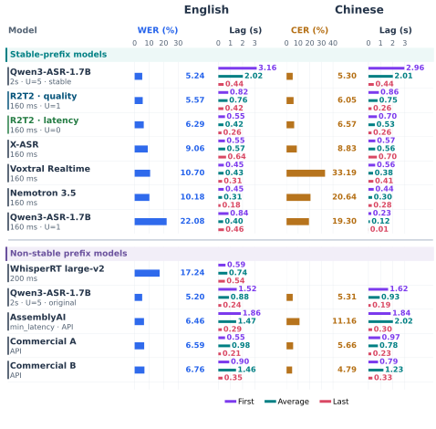
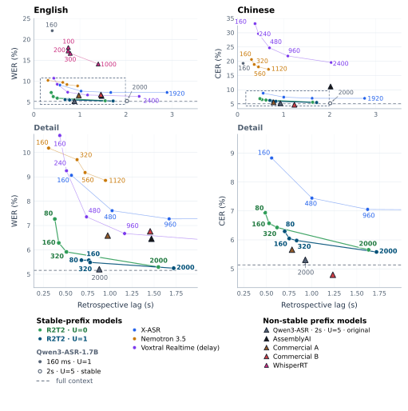

<div align="center">
    
    <h1>Confucius4-<span style="color: #4F8CFF;">R2T2</span>: A Stable-Prefix Streaming ASR Model for Real Real-Time Transcription</h1>
        <p>
        <b>
            <span style="color: #4F8CFF;">R</span>eal
            <span style="color: #4F8CFF;">R</span>eal-<span style="color: #4F8CFF;">T</span>ime
            <span style="color: #4F8CFF;">T</span>ranscription
        </b>
    </p>
</div>

<div align="center">
    <a href="./README.md"></a>
    &nbsp;&nbsp;&nbsp;&nbsp;
    <a href="./LICENSE"></a>
    &nbsp;&nbsp;&nbsp;&nbsp;
    <a href="https://r2t2.youdao.com/demo"></a>
    &nbsp;&nbsp;&nbsp;&nbsp;
    <a href="https://huggingface.co/netease-youdao/Confucius4-R2T2"></a>
    &nbsp;&nbsp;&nbsp;&nbsp;
    <a href="https://modelscope.cn/models/netease-youdao/Confucius4-R2T2"></a>
    &nbsp;&nbsp;&nbsp;&nbsp;
    <a href="https://arxiv.org/abs/2611.06043"></a>
    &nbsp;&nbsp;&nbsp;&nbsp;
    <a href="https://r2t2.ai/"></a>
    &nbsp;&nbsp;&nbsp;&nbsp;
</div>
<br>

Confucius4-R2T2 是一款低延迟、高准确率的稳定前缀流式自动语音识别（ASR）模型，支持以 80 毫秒到 2 秒的不同细粒度音频步长进行流式解码。该模型采用单调输出模式：即已提交的识别文本稳定不变，且无需后续修正。这对于那些识别文本必须被即时处理或操作的语音交互应用场景至关重要，例如实时字幕、同声传译、下游 NLP 与 LLM 智能体等等。这种真流式可带来更流畅的用户体验，避免实时应用中频繁修改文本和界面闪烁等问题。

R2T2 是 Real Real-Time Transcription（真正实时转写）的缩写。该模型在 1,500 小时专有中英文音频上，通过最长稳定前缀（Longest Stable Prefix，LSP）学习范式对 **Qwen3-ASR-1.7B** 进行了流式识别场景适配。整个训练过程分成 SFT 微调阶段和 GRPO 强化学习阶段，且仅训练语言解码器；预训练的音频编码器和投影器保持冻结，整体模型架构不做任何修改。训练过程中，LSP 监督信号以及显式的 `Wait` 操作训练模型哪些内容可以稳定提交，以及何时需要等待更多的音频。

- **准确的流式识别** — 在 160 毫秒音频步长、保留一个临时词元的配置下，模型识别错误率为 **5.76%**，基础模型在相同流式设置下为 **21.01%**。在包含中英文的 13 个测试集上，R2T2 位列此次评测的开源模型第一，整体表现逼近完整上下文推理的参考值（**5.15%**）。
- **稳定的输出** — 无论是质量优先（`U=1`）还是延迟优先（`U=0`）模式，R2T2 只提交稳定识别文本，临时后缀始终保留在模型内部。
- **可配置的响应速度** — 无需重新训练，即可通过调整分块时长和临时词元预算控制准确率与输出延迟之间的权衡。
- **离线与流式推理** — 同时支持离线和流式识别。
- **推理后端** — 支持 vLLM 推理、Hugging Face `transformers` 离线推理，以及可选的 llama.cpp 解码。
- **上下文和热词** — 原生支持。
- **多语言迁移** — 针对 **中文和英文** 进行了优化，同时支持广泛的其他语言。

形式化定义、证明和完整评测详情请阅读 [arXiv 论文](https://arxiv.org/abs/2611.06043)。

## 目录

- [概览](#概览)
- [演示](#演示)
  - [与 GPT-Live-Transcribe 的对比](#与-gpt-live-transcribe-的对比)
  - [其他资源](#其他资源)
- [评测](#评测)
  - [流式性能](#流式性能)
  - [准确率](#准确率)
    - [英文](#英文)
    - [中文](#中文)
  - [跨语言迁移](#跨语言迁移)
- [模型检查点](#模型检查点)
- [安装](#安装)
  - [克隆仓库](#克隆仓库)
  - [方式 1：Conda](#方式-1conda)
  - [方式 2：uv](#方式-2uv)
- [Docker（推荐）](#docker推荐)
  - [1. 启动容器](#1-启动容器)
  - [2. 在容器中运行示例](#2-在容器中运行示例)
  - [3. 管理容器](#3-管理容器)
- [快速开始](#快速开始)
  - [配置](#配置)
- [Python API](#python-api)
  - [vLLM 后端](#vllm-后端)
    - [离线转写](#离线转写)
    - [流式转写](#流式转写)
  - [llama.cpp 后端](#llamacpp-后端)
- [WebSocket 服务](#websocket-服务)
  - [启动与停止服务](#启动与停止服务)
  - [WebSocket 端点](#websocket-端点)
  - [消息格式](#消息格式)
  - [客户端示例](#客户端示例)
- [支持的语言](#支持的语言)
- [社区与联系](#社区与联系)
  - [微信群](#微信群)
  - [Discord 社区](#discord-社区)
  - [商务联系](#商务联系)
  - [GitHub Issues](#github-issues)
- [致谢](#致谢)
- [引用](#引用)
- [许可证](#许可证)

---

## 概览

<div align="center">
  
  <p><i>图 1：R2T2 总体框架。</i></p>
</div>

## 演示

### 与 GPT-Live-Transcribe 的对比

<div align="center">
  <video controls playsinline preload="metadata" width="90%" src="https://github.com/user-attachments/assets/1b21c04a-766a-434f-96dc-580376b305f1" title="GPT-Live-Transcribe 与 R2T2 同时实时处理相同音频的对比。">
    <!-- GitLab 会将此备用图像转换为视频播放器。 -->
    
  </video>
  <p><i>图 2：GPT-Live-Transcribe 与 R2T2 同时实时处理相同音频的对比。</i></p>
</div>

### 其他资源

更多演示与对比可在 [r2t2.youdao.com/examples](https://r2t2.youdao.com/examples/) 查看，涵盖分块大小、上下文与热词、中英混说、多语种、噪声、长语音等场景。

## 评测

> 欢迎参与对比的模型的作者和维护者通过仓库的 Issues 联系我们，共同核实或讨论评测结果。

### 流式性能

`U` 表示暂不释放的临时词元数量。在 160 毫秒设置下，`U=1` 优先保证识别质量，`U=0` 优先降低输出延迟。R2T2 的两种模式都会保留已提交的文本。对比图中还将 2 秒设置下带有可见、可修改后缀的基础模型，与隐藏后缀的设置进行了对比。

<div align="center">
  
  <p><i>英文 WER、中文 CER 与回溯式输出延迟。First 和 Last 分别表示首个和最后一个匹配单元的平均延迟；Average 表示所有评测数据集上的平均延迟。</i></p>
</div>

<div align="center">
  
  <p><i>不同分块大小和临时词元预算下的识别准确率与延迟权衡。曲线连接实测配置；三角形表示包含可修改假设的配置。</i></p>
</div>

**回溯式输出延迟**（retrospective emission lag）在音频时间轴上度量：相对于参考文本对应单元经过强制对齐的结束位置，输出前缀何时首次永久稳定。该指标使用 Levenshtein 对齐匹配相同单元，并排除高错误率语句；不包含执行、排队、传输和渲染时间。

### 准确率

英文使用 WER（%），中文使用 CER（%）；数值越低越好。13 个测试集的总宏平均中，每个数据集具有相同权重。

在下方的完整对比中，**Base** 表示 Qwen3-ASR-1.7B。除 Base 2 秒和 WhisperRT（200 ms）外，所有流式列均使用 160 毫秒。Base 160 ms 使用 `U=1`；Base 2 秒使用 `U=5`。**†** 表示仅用于参考、不参与排名的配置；**\*** 表示可见的可修改假设。粗体表示每一行中符合排名条件的最低错误率；N/A 表示不可用。

#### 英文

| Dataset | Base offline† | Base 2 s†\* | Base 160 ms | R2T2 U=1 | R2T2 U=0 | X-ASR | WhisperRT\* | Nemotron 3.5 | Voxtral RT | AssemblyAI\* | Comm. A\* | Comm. B\* |
| --- | ---: | ---: | ---: | ---: | ---: | ---: | ---: | ---: | ---: | ---: | ---: | ---: |
| AMI | 9.18 | 9.25 | 24.79 | 10.07 | 10.40 | 14.41 | 24.19 | 18.11 | 17.58 | 12.00 | 13.27 | **8.44** |
| Giga-clean | 8.60 | 8.61 | 24.37 | **8.81** | 9.04 | 10.26 | 13.81 | 12.67 | 12.16 | 9.21 | 8.84 | 9.46 |
| LS-clean | 1.62 | 1.67 | 18.37 | 1.91 | 2.12 | 3.86 | 4.70 | 3.71 | 3.05 | 1.89 | 1.73 | **1.25** |
| LS-other | 3.39 | 3.54 | 25.74 | 4.12 | 4.55 | 9.64 | 9.86 | 8.27 | 8.70 | 3.37 | 3.57 | **2.48** |
| VoxPopuli | 3.12 | 3.02 | 20.71 | **2.29** | 3.54 | 5.68 | 8.28 | 5.69 | 8.00 | 4.75 | 3.17 | 3.14 |
| Earnings22 | 6.26 | 6.68 | 29.72 | 7.61 | 9.06 | 15.95 | 35.08 | 17.22 | 12.12 | **7.47** | 10.32 | 8.96 |
| TED-LIUM | 2.26 | 2.33 | 19.18 | **2.46** | 2.77 | 3.75 | 6.67 | 5.11 | 5.89 | 3.23 | 3.08 | 3.30 |
| EN-RealSI | 6.84 | 6.54 | 13.76 | **7.33** | 8.84 | 8.97 | 35.36 | 10.69 | 18.08 | 9.73 | 8.73 | 17.05 |

#### 中文

| Dataset | Base offline† | Base 2 s†\* | Base 160 ms | R2T2 U=1 | R2T2 U=0 | X-ASR | WhisperRT\* | Nemotron 3.5 | Voxtral RT | AssemblyAI\* | Comm. A\* | Comm. B\* |
| --- | ---: | ---: | ---: | ---: | ---: | ---: | ---: | ---: | ---: | ---: | ---: | ---: |
| Wenet-net | 4.87 | 4.94 | 19.79 | 5.75 | 6.17 | 8.81 | N/A | 24.70 | 27.36 | 12.91 | 5.13 | **4.79** |
| Wenet-meeting | 5.85 | 5.97 | 20.38 | 6.74 | 7.34 | 11.33 | N/A | 20.18 | 66.50 | 11.84 | 7.07 | **3.75** |
| SPEECHIO-06 | 5.90 | 6.10 | 24.47 | 7.19 | 7.43 | 7.86 | N/A | 22.52 | 35.33 | 15.08 | 5.67 | **5.34** |
| SPEECHIO-07 | 6.15 | 6.19 | 21.16 | 7.29 | 7.94 | 11.22 | N/A | 24.28 | 26.84 | 10.84 | **6.45** | 6.46 |
| CN-RealSI | 2.91 | 3.34 | 10.72 | **3.27** | 3.98 | 4.92 | N/A | 11.52 | 9.92 | 5.15 | 3.99 | 3.64 |

### 跨语言迁移

下表涵盖后训练未使用的十种语言，共 18 个测试集。日语、韩语和泰语使用 CER（字符错误率）；其余语言使用 WER（词错误率）。这些测试集不计入中英文主评测的平均值。

| Test set | Base offline | Base 2 s, U=5 | Base 160 ms, U=1 | R2T2 160 ms, U=0 | R2T2 160 ms, U=1 |
| --- | ---: | ---: | ---: | ---: | ---: |
| Arabic: FLEURS | 9.53 | 11.32 | 56.63 | 14.86 | 13.52 |
| German: FLEURS | 3.95 | 10.77 | 36.49 | 12.35 | 8.05 |
| German: MLS | 6.99 | 7.55 | 26.83 | 12.09 | 9.52 |
| Spanish: FLEURS | 2.63 | 3.55 | 31.00 | 5.22 | 3.97 |
| Spanish: MLS | 3.81 | 3.80 | 18.36 | 5.45 | 4.47 |
| French: FLEURS | 4.30 | 5.67 | 39.61 | 7.65 | 6.35 |
| French: MLS | 5.09 | 5.43 | 22.12 | 6.90 | 6.14 |
| Japanese: FLEURS | 5.42 | 7.23 | 36.07 | 10.15 | 8.66 |
| Korean: FLEURS | 4.22 | 6.20 | 40.66 | 6.77 | 7.52 |
| Portuguese: FLEURS | 4.47 | 5.02 | 23.94 | 8.02 | 6.76 |
| Portuguese: MLS | 6.43 | 6.65 | 20.94 | 8.64 | 7.41 |
| Russian: FLEURS | 4.94 | 6.95 | 53.92 | 11.26 | 8.26 |
| Thai: Common Voice | 3.50 | 3.62 | 24.12 | 5.58 | 5.18 |
| Thai: FLEURS | 6.81 | 8.40 | 21.25 | 10.14 | 9.83 |
| Thai: GigaSpeech2 | 12.39 | 12.97 | 18.43 | 15.39 | 14.93 |
| Vietnamese: Common Voice | 8.48 | 8.51 | 38.92 | 11.87 | 11.25 |
| Vietnamese: FLEURS | 6.99 | 8.66 | 28.11 | 11.88 | 10.89 |
| Vietnamese: GigaSpeech2 | 7.85 | 7.83 | 16.04 | 8.65 | 8.42 |
| **Macro average** | **5.99** | **7.23** | **30.75** | **9.60** | **8.40** |

## 模型检查点

模型权重已发布到 Hugging Face 和 ModelScope 平台。请选择与推理后端对应的模型检查点：

| Inference backend | Model | Hugging Face | ModelScope | Description |
| ----------------- | ----- | ------------ | ---------- | ----------- |
| vLLM | `Confucius4-R2T2` | <a href="https://huggingface.co/netease-youdao/Confucius4-R2T2" title="在 Hugging Face 上打开 Confucius4-R2T2"></a> | <a href="https://modelscope.cn/models/netease-youdao/Confucius4-R2T2" title="在 ModelScope 上打开 Confucius4-R2T2"></a> | vLLM 后端的标准检查点 |
| llama.cpp | `Confucius4-R2T2-GGUF` | <a href="https://huggingface.co/netease-youdao/Confucius4-R2T2-GGUF" title="在 Hugging Face 上打开 Confucius4-R2T2-GGUF"></a> | <a href="https://modelscope.cn/models/netease-youdao/Confucius4-R2T2-GGUF" title="在 ModelScope 上打开 Confucius4-R2T2-GGUF"></a> | 包含多种量化版本的 GGUF 仓库 |

## 安装

我们建议使用一个**全新且隔离的环境**。本地开发和从源码安装时，请使用下方的 **Conda** 或 **uv** 环境。若要快速运行项目，推荐使用已经预配置 CUDA 和运行时环境的 **Docker**，详见 [Docker](#docker推荐)。

### 克隆仓库

```bash
git clone https://github.com/netease-youdao/Confucius4-R2T2.git
cd Confucius4-R2T2
```

### 方式 1：Conda

```bash
conda create -n confucius4-r2t2 python=3.12 -y
conda activate confucius4-r2t2

# 安装带 vLLM 后端的程序包
pip install -e .
```

### 方式 2：uv

```bash
uv venv --python 3.12
source .venv/bin/activate

# 安装带 vLLM 后端的程序包
uv pip install -e .
```

支持 Python 3.10 及以上版本。我们测试使用的版本是 Python 3.12。

vLLM 对 CUDA / PyTorch 版本兼容性有严格要求。如果安装时无法解析依赖，请查看 [vLLM 网站](https://docs.vllm.ai/) 上的版本矩阵，并固定与 CUDA 运行时匹配的版本组合。

## Docker（推荐）

R2T2 可以直接运行在官方 **Qwen3-ASR** Docker 镜像中，该镜像已经包含我们所需的全部运行时库。

预构建镜像：[qwenllm/qwen3-asr](https://hub.docker.com/r/qwenllm/qwen3-asr)。

开始前，请安装 [NVIDIA Container Toolkit](https://docs.nvidia.com/datacenter/cloud-native/container-toolkit/latest/install-guide.html)，以启用 Docker 的 GPU 访问权限。如果所在地区访问 Docker Hub 较慢或不稳定，可能需要配置镜像仓库。

### 1. 启动容器

```bash
LOCAL_WORKDIR=/path/to/your/workspace   # 将挂载到容器中的主机路径
HOST_PORT=8000
CONTAINER_PORT=80

docker run --gpus all --name confucius4-r2t2 \
    -v /var/run/docker.sock:/var/run/docker.sock \
    -p $HOST_PORT:$CONTAINER_PORT \
    --mount type=bind,source=$LOCAL_WORKDIR,target=/data/shared/confucius4-r2t2 \
    --shm-size=4gb \
    -it qwenllm/qwen3-asr:latest
```

本地工作区（`$LOCAL_WORKDIR`，包括本仓库的检出目录和 R2T2 检查点）会挂载到容器内的 `/data/shared/confucius4-r2t2`。主机的 8000 端口映射到容器的 80 端口；容器内运行的服务必须绑定到 `0.0.0.0`（不能是 `127.0.0.1`），端口转发才能正常工作。

### 2. 在容器中运行示例

进入容器的 shell 后执行：

```bash
cd /data/shared/confucius4-r2t2/Confucius4-R2T2
MODEL_PATH=/data/shared/confucius4-r2t2/Confucius4-R2T2 \
    ./run_example.sh /path/to/audio.wav
```

### 3. 管理容器

```bash
# 退出后重新进入
docker start confucius4-r2t2
docker exec -it confucius4-r2t2 bash

# 完全删除
docker rm -f confucius4-r2t2
```

## 快速开始

准备任意音频文件（单声道或立体声、任意采样率，程序会在内部重采样至 16 kHz），然后运行：

```bash
./run_example.sh /path/to/audio.wav \
    --model_path /path/to/Confucius4-R2T2 \
    --infer_mode stream_vllm \
    --language Chinese \
    --chunk_size_ms 160
```

日志默认写入 `run_example.log`。运行 `./run_example.sh --help` 可查看完整的参数列表。

### 配置

`run_example.sh` 会读取以下环境变量。模型路径和音频可通过环境变量或命令行参数提供。

| 变量 | 默认值 | 说明 |
| --------------------- | ------------------ | ------------------------------------------------------ |
| `MODEL_PATH` | （必填） | R2T2 检查点的路径或 HF 仓库 ID |
| `AUDIO` | 第一个命令行参数 | 输入音频文件路径 |
| `INFER_MODE` | `stream_vllm` | `stream_vllm` 或 `onetime_vllm` |
| `LANGUAGE` | `Chinese` | 语言提示（例如 `Chinese`、`English` 等） |
| `CHUNK_SIZE_MS` | `160` | 流式分块大小（支持 80 毫秒至 2 秒） |
| `UNFIXED_TOKEN_NUM` | `1` | 临时词元预算 U：`1` 表示优先保证质量，`0` 表示优先降低延迟 |
| `LOOKAHEAD_MS` | `160` | 仅为首次更新额外缓冲的音频时长（毫秒） |
| `CONTEXT` | `""` | 添加到提示词前的上下文 / 热词提示 |
| `CUDA_VISIBLE_DEVICES` | `0` | 向程序暴露的 GPU ID |
| `LOG_FILE` | `run_example.log` | 日志写入位置 |

你也可以直接调用 `example.py`，并通过参数传入上述配置（`--audio`、`--model_path`、`--infer_mode`、`--language`、`--chunk_size_ms`、`--lookahead_ms`、`--unfixed_token_num`、`--context`）。

## Python API

音频输入可以是本地路径、URL、Base64 数据，或 `(np.ndarray, sr)` 元组。支持批量推理。请记得将 vLLM 代码放在 `if __name__ == '__main__':` 下，以避免 [vLLM 故障排查文档](https://docs.vllm.ai/en/latest/usage/troubleshooting/#python-multiprocessing) 中所述的 `spawn` 错误。

### vLLM 后端

#### 离线转写

```python
import librosa
from r2t2 import R2T2ASRModel

if __name__ == "__main__":
    asr = R2T2ASRModel.LLM(
        model="/path/to/Confucius4-R2T2",
        gpu_memory_utilization=0.5,
        max_model_len=16384,
        max_inference_batch_size=32,
        max_new_tokens=4096,
    )

    wav, sr = librosa.load("path/to/audio.wav", sr=16000, mono=True)

    results = asr.transcribe(
        audio=[(wav, 16000)],
        language=["Chinese"],       # or [None]
        return_time_stamps=False,
    )
    print(results[0].language, results[0].text)
```

#### 流式转写

示例使用 `unfixed_token_num=1`（质量优先）；设置为 `0` 可优先降低延迟。当下游文本必须保持稳定时，请使用第二个返回值，即最终确定的前缀。`state.text` 和第一个返回值包含当前假设，其中包括临时后缀。最后一次调用会刷新缓冲区中的尾部音频。这些示例配置并不是完整复现论文结果的配置。

```python
import librosa
from r2t2 import R2T2ASRModel

if __name__ == "__main__":
    asr = R2T2ASRModel.LLM(
        model="/path/to/Confucius4-R2T2",
        gpu_memory_utilization=0.4,
        max_model_len=16384,
        max_new_tokens=4,           # 保持较小以实现低延迟流式处理
    )

    wav, sr = librosa.load("path/to/audio.wav", sr=16000, mono=True)

    state = asr.init_streaming_state(
        context="",                 # 可选的热词 / 主题提示
        language="Chinese",         # or None
        unfixed_chunk_num=0,
        unfixed_token_num=1,
        chunk_size_sec=0.16,
    )

    step = int(0.16 * 16000)
    for pos in range(0, len(wav), step):
        seg = wav[pos : pos + step]
        _, text = asr.streaming_transcribe(seg, state, max_new_tokens=4)
        print("text:", text)

    asr.finish_streaming_transcribe(state)
    print("final:", state.text)
```

有关带自适应 `max_new_tokens` 和首个分块预读处理的完整流式示例，请参阅 [`example.py`](./example.py)。

### llama.cpp 后端

[`r2t2_llama/`](./r2t2_llama) 程序包为偏好使用 llama.cpp 运行时的部署场景提供解码支持。共有以下三种方式：

| 模式 | 音频编码器 | 解码器 |
| --- | --- | --- |
| `stream_llama_hybrid` | vLLM 原生编码器（PyTorch） | llama.cpp |
| `stream_llama` | llama.cpp | llama.cpp |
| `onetime_llama` | llama.cpp | llama.cpp |

```bash
GGUF_DIR=/path/to/gguf python -m r2t2_llama.example_llama \
    --audio resources/test.wav \
    --model_path /path/to/Confucius4-R2T2 \
    --infer_mode stream_llama_hybrid
```

程序包中已提供适用于 CPython 3.12 的预构建 CUDA 构件，因此运行时无需检出 llama.cpp。固定使用的 llama.cpp 版本、Python API 及重新构建说明，请参阅 [`r2t2_llama/README.md`](./r2t2_llama/README.md)。

## WebSocket 服务

为支持实时、多客户端流式 ASR，本仓库提供了开箱即用的 WebSocket 服务（`ws_server.py`）、启动脚本（`run_start_server.sh`）和 Python 客户端示例（`ws_client.py`）。

### 启动与停止服务

```bash
# 使用 VAD 模型启动
./run_start_server.sh start \
    --model_path /path/to/Confucius4-R2T2 \
    --vad_model_path /path/to/Stream-VAD \
    --port 8272 \
    --gpu 0

# 停止
./run_start_server.sh kill

# 一步重启
./run_start_server.sh restart \
    --model_path /path/to/Confucius4-R2T2 \
    --vad_model_path /path/to/Stream-VAD \
    --port 8272 \
    --gpu 0
```

| 参数 | 环境变量 | 默认值 | 说明 |
| --------------------- | -------------------- | -------------------------------------------------------------- | ---------------------------------------------------- |
| `-m`、`--model_path` | `ASR_MODEL_PATH` | （必填） | R2T2 检查点的路径或 HF 仓库 ID |
| `-v`、`--vad_model_path` | `VAD_MODEL_PATH` | `checkpoints/vad/Stream-VAD` | FireRedVAD Stream-VAD 模型的路径 |
| `-p`、`--port` | `PORT` | `8272` | WebSocket 服务绑定的端口 |
| `-g`、`--gpu` | `CUDA_VISIBLE_DEVICES` | `0` | 向服务进程暴露的 GPU ID |
| `-h`、`--host` | `HOST_TAG` | `localhost` | 仅用于日志文件名的主机标签 |

启动器会解析自身所在目录，因此可以从任意位置调用。日志会写入当前目录下的 `nohup_service_ws_<host_tag>_<port>.log`。FireRedVAD 模型可从 [Hugging Face](https://huggingface.co/FireRedTeam/FireRedVAD/tree/main) 获取。建议将模型文件下载到本仓库的 `checkpoints` 目录中：

```bash
# FireRedVAD 仓库包含多个检测器，但这里只需要流式检测器。
# 以下两条命令都会保留 `Stream-VAD/` 文件夹名称，因此文件会直接放在
# checkpoints/vad/Stream-VAD 中，不会产生额外的嵌套目录。

# 方式 A：hf CLI（pip install -U "huggingface_hub[cli]"）
hf download FireRedTeam/FireRedVAD \
    --include "Stream-VAD/*" \
    --local-dir checkpoints/vad

# 方式 B：git clone
git clone https://huggingface.co/FireRedTeam/FireRedVAD
mkdir -p checkpoints/vad
cp -r FireRedVAD/Stream-VAD checkpoints/vad/
```

无论使用哪条命令，模型都会位于 `checkpoints/vad/Stream-VAD`，这正是 `--vad_model_path` 的默认路径，因此可以完全省略该参数。

### WebSocket 端点

| 路径 | 行为 |
| -------------------------- | ------------------------------------------------------------------------ |
| `/asr_stream_api_v1` | 流式 ASR。每条消息中的 `text` 都是**新增的（增量）**片段。 |

### 消息格式

**客户端 → 服务端：**

- 以 `int16` 二进制帧发送 16 kHz 单声道 PCM（参考客户端每帧约 160 毫秒，即 2560 个采样点 × 2 字节）。
- 发送字符串 `"YOUDAO_ONETIME_ASR_STREAM_EOS"` 表示音频结束；服务端会发送所有剩余文本并关闭连接。

**服务端 → 客户端：** JSON 消息格式如下：

```json
{
  "status": "success",
  "requestId": "<uuid>",
  "msg": {
    "text": "hello",
    "reset": false,
    "asr_cost_ms": 35.4,
    "total_cost_ms": 42.0
  }
}
```

- `text` 是自上一条消息以来新识别出的（增量）片段。客户端将这些片段拼接起来即可得到完整转写文本。

### 客户端示例

`ws_client.py` 是一个最小示例，会将 WAV 文件流式发送到服务端并打印响应。

```bash
# 使用默认 URI（ws://localhost:8272/asr_stream_api_v1）和内置示例音频
python ws_client.py

# 指定自定义端点和音频文件
python ws_client.py \
    --uri wss://your.host/asr_stream_api_v1 \
    --audio resources/test.wav \
    --save service_ws_test \
    --audio-id test.wav
```

命令行选项：

| 参数 | 环境变量 | 默认值 | 说明 |
| -------------------- | -------------- | --------------------------------------------- | ------------------------------------------------------------------ |
| `--uri` / `-u` | `ASR_WS_URI` | `ws://localhost:8272/asr_stream_api_v1` | 要连接的 WebSocket 端点。 |
| `--audio` / `-a` | — | 内置示例路径 | 输入音频文件（推荐使用 16 kHz 单声道 WAV）。 |
| `--save` / `-s` | — | `service_ws_test` | 用于追加保存最终转写文本的文件。 |
| `--audio-id` | — | `--audio` 的文件名 | 写入 `--save` 中结果旁边的标识符。 |

## 支持的语言

R2T2 主要针对中文和英文流式识别进行了优化。除这两种主要语言外，它还保留了对法语、德语、意大利语、日语、韩语、葡萄牙语、俄语、西班牙语、阿拉伯语等语言的实用跨语言流式识别能力。

## 社区与联系

欢迎加入我们的社区，提问、分享想法，并与其他用户和开发者交流。

### 微信群

扫描下方二维码加入微信群：


### Discord 社区

[加入我们的 Discord 社区](https://discord.gg/GfhaWkCyb)

### 商务联系

如需高并发、生产级、可在国内部署或私有化部署的解决方案，或有商务咨询与合作需求，欢迎通过以下方式联系我们。

- **电话：** +86 010-82558901
- **邮箱：** [AIcloud_Business@corp.youdao.com](mailto:AIcloud_Business@corp.youdao.com)

### GitHub Issues

也欢迎在本仓库的 [Issues](https://github.com/netease-youdao/Confucius4-R2T2/issues) 区域参与讨论。欢迎提问、报告错误或提出改进建议！

---

## 致谢

衷心感谢阿里巴巴 Qwen 团队开源 [Qwen3-ASR](https://github.com/QwenLM/Qwen3-ASR) 模型代码，为 R2T2 提供了架构基础。

## 引用

如果你在研究中使用本仓库或 R2T2 模型检查点，请引用 **Confucius4-R2T2**（本项目）：

```bibtex
@article{huang2026confucius4r2t2,
  title         = {Confucius4-R2T2: A Stable-Prefix Streaming ASR Model for Real Real-Time Transcription},
  author        = {Huang, Daniel and He, Qi and Duan, Shaoxiong and Li, Yingjie and Cheng, Qiao and Duan, Yitao},
  year          = {2026},
  eprint        = {2611.06043},
  archivePrefix = {arXiv},
  primaryClass  = {cs.CL},
  url           = {https://arxiv.org/abs/2611.06043}
}
```

## 许可证

R2T2 采用**双重许可**，以区分源代码和模型权重：

- 本仓库中的**代码**根据 [Apache License 2.0](./LICENSE) 发布，可在该许可证条款下免费使用、修改和再分发（包括商业用途）。
- **模型权重**根据 [网易模型使用许可协议](MODEL_LICENSE_zh) 发布。

## Star 历史

<a href="https://www.star-history.com/?repos=netease-youdao%2Fconfucius4-r2t2&type=date&legend=top-left">
 <picture>
   <source media="(prefers-color-scheme: dark)" srcset="https://api.star-history.com/chart?repos=netease-youdao/confucius4-r2t2&type=date&theme=dark&legend=top-left" />
   <source media="(prefers-color-scheme: light)" srcset="https://api.star-history.com/chart?repos=netease-youdao/confucius4-r2t2&type=date&legend=top-left" />
   
 </picture>
</a>
